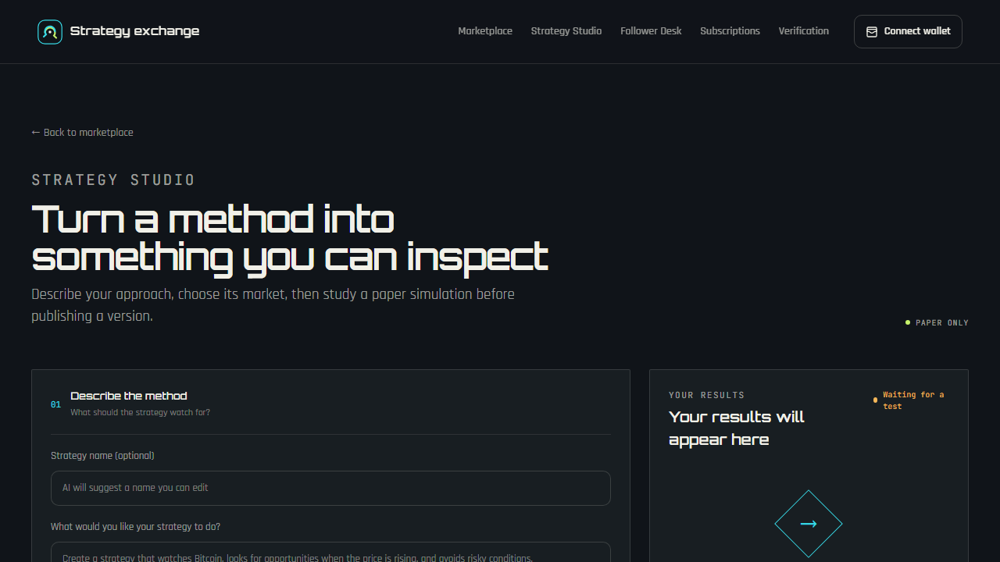
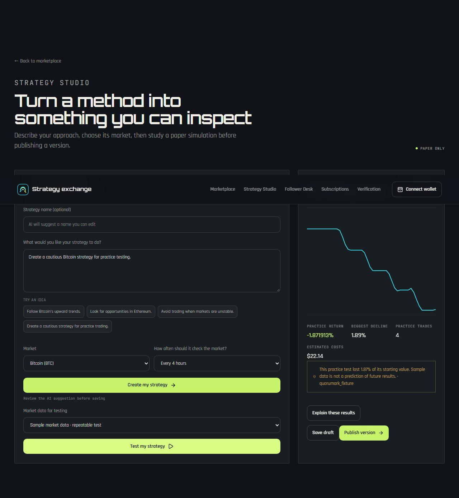
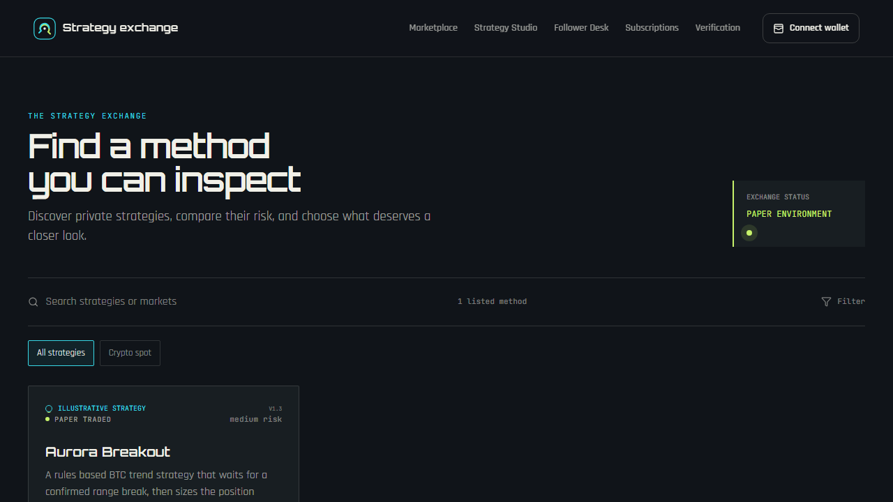
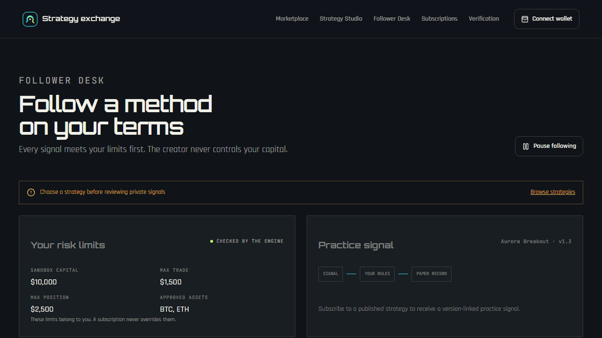
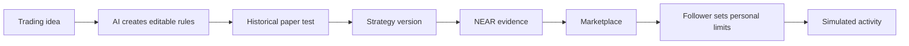
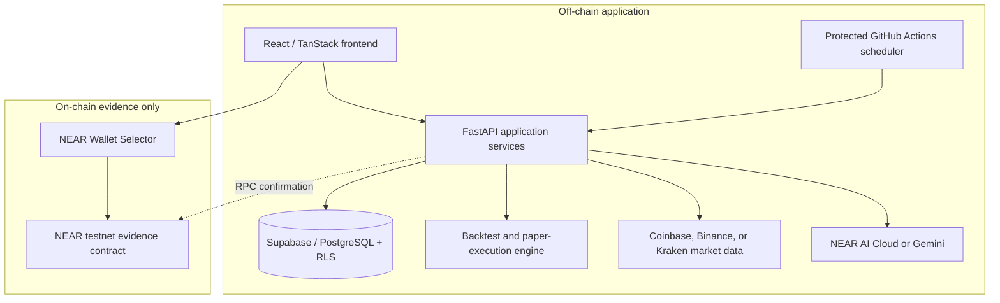

# Quorumark

> An AI-powered marketplace for creating, testing, verifying, and following automated trading strategies.

Turning a trading idea into an automated strategy is complicated. Testing whether it works, showing others how it performed, and making it available for people to follow introduces even more challenges.

Quorumark brings those steps together.

Creators can describe trading ideas in everyday language, turn them into editable strategies with AI, test them against historical market data, and make them available through a marketplace. Followers can explore available performance information, inspect verification evidence, and apply their own risk limits.

A key part of Quorumark is verifying a strategy without exposing its private rules. Using NEAR, creators can establish an independently inspectable record tied to a particular strategy version.

Quorumark was developed for the NEAR Hackathon 2026.

[Launch Quorumark](https://quorumark-web.onrender.com) | Demonstration video: no public URL is configured in this repository.

**Current scope:** Quorumark supports simulated strategy testing and paper-based evaluation. It does not execute real-money trades. Historical results do not guarantee future performance.

## Try Quorumark

The best way to understand Quorumark is to use it.

The walkthrough below follows the main product experience, from discovering a strategy to creating, testing, and verifying one.

### A guided walkthrough

| Step | What to do | What you should see |
|---|---|---|
| 1. Explore | Open Quorumark and select Marketplace. | A collection of available automated trading strategies. |
| 2. Examine | Open a strategy that interests you. | Its description, available simulated performance, and supporting information. |
| 3. Create | Open Strategy Studio and describe a trading idea in plain English. | AI-assisted strategy rules that can be reviewed and edited. |
| 4. Refine | Adjust the available entry, exit, and risk settings. | An updated strategy configuration reflecting your changes. |
| 5. Test | Run a historical test using the available market data. | Simulated trades and a performance report. |
| 6. Investigate | Examine the performance report. | Returns, drawdowns, trading activity, and other available metrics. |
| 7. Verify | Open the strategy's verification information. | Evidence associated with its recorded strategy version, including NEAR testnet information where available. |
| 8. Follow | Open the follower controls for an available strategy. | Settings that allow the follower to define independent risk limits. |
| 9. Review | Visit the available activity or decisions view. | Recorded strategy evaluations and simulated activity. |

Some actions require wallet authorization or an appropriately configured account. The deployed application should identify these requirements before the relevant action.

For judges: The walkthrough demonstrates the intended end-to-end experience. Features requiring additional setup are identified in the technical instructions below. The public demonstration video provides a guided view of the complete product.

### What to look for

Three distinctions are important when evaluating Quorumark:

- AI creates editable rules, not guaranteed winning strategies. The creator remains responsible for reviewing and adjusting the generated strategy.

- Historical testing is a simulation. Performance figures are produced from defined assumptions and historical data, not from live investment returns.

- NEAR records verifiable evidence of strategy versions. It does not certify a strategy's profitability or guarantee its performance.

## Why Quorumark exists

Automated trading tools often separate the people who create strategies from the people who want to use them.

A creator may have a promising idea but lack the tools to turn it into a structured strategy. Testing may require another application. Sharing results may mean publishing screenshots that provide little evidence of how they were produced.

For followers, the challenge is different. A strategy may have attractive performance figures, but those figures alone do not establish which version was tested or how much risk following it might involve.

There is also a legitimate reason creators may not want to disclose everything: the rules behind a strategy can represent significant work.

Quorumark addresses these problems together.

It provides a place to develop strategies, examine simulated results, create verifiable records of strategy versions, and make strategies discoverable without requiring creators to publish their private methods.

Followers retain control over their own risk settings.

The goal is not to remove uncertainty from trading. It is to make the process of creating, evaluating, and following strategies more accessible and accountable.

## From an idea to an automated strategy

### 1. Create with AI

Strategy Studio begins with a description rather than a programming language.

A creator can describe a trading approach in plain English. Quorumark uses AI to translate that description into structured rules that the application can work with.

Those rules can include entry conditions, exit conditions, and risk parameters.

The result is not an unchangeable AI recommendation. Creators can inspect and modify the available rules before testing them.

This matters because AI should make strategy development more accessible without hiding the decisions that determine how a strategy behaves.



### 2. Test against historical market data

An idea that sounds reasonable still needs to be tested.

Quorumark includes a historical testing system that simulates how a strategy would have behaved under specified market conditions.

The simulation accounts for execution assumptions, including trading costs and slippage, rather than treating every trade as free or perfectly executed.

Its results can include:

- Simulated returns and changes in portfolio value.
- Maximum drawdown, showing the largest decline from a previous peak.
- Trading activity, including entries and exits.
- Fees and other simulated execution costs.
- A performance chart showing how the simulated account changed over time.

Quorumark also uses a next-interval execution approach in its reference backtesting logic. A trading decision is not allowed to use information from a future market interval and then pretend the trade happened earlier.

That distinction matters because historical tests can produce misleading results when they allow a strategy to act on information it could not have known.



### 3. Improve the strategy

A test is useful because it reveals more than a single return figure.

Creators can examine how frequently a strategy trades, how its simulated results change over time, and how much risk its behavior introduces.

They can then adjust the available strategy settings and test again.

This creates a repeatable development process:

> Describe an idea → Review the rules → Test → Examine the results → Refine

The objective is to make strategy development understandable and measurable, not to suggest that a successful historical test guarantees a successful future outcome.

## A marketplace for strategies, not trading tips

Quorumark is designed around automated strategies as reusable products.

A trading tip tells someone what action to consider at a particular moment. An automated strategy defines rules for evaluating market conditions and producing decisions over time.

That difference is central to Quorumark.

Creators can make strategies available for discovery alongside their descriptions, available simulated performance, and verification evidence.

Followers can compare the information provided, explore a strategy's characteristics, and decide whether its approach suits their own requirements.



## Followers keep their own risk controls

Following a strategy should not require accepting every risk preference chosen by its creator.

Quorumark separates the creator's strategy rules from the follower's available risk controls.

This allows followers to establish their own limits within the supported paper-trading environment.

The creator defines the strategy. The follower controls the risk settings available to their own simulated participation.

That separation is an important part of the marketplace's design.



## Why NEAR matters

There is a problem that historical performance reports cannot solve on their own.

Imagine a creator tests a strategy, shares the results, and later changes the underlying rules.

How can someone establish which strategy version was associated with the original publication?

And how can the creator provide evidence without revealing the private trading logic?

Quorumark uses NEAR to address this specific problem.

### Verifiable strategy versions

When a strategy version is prepared for verification, Quorumark creates a cryptographic commitment associated with that version.

A creator authorizes the relevant action using a NEAR wallet. The commitment is then recorded through a smart contract on NEAR testnet.

This provides a record that can be inspected independently of Quorumark's own interface.

If a strategy is revised, the revised version can be associated with a separate commitment.

The underlying strategy rules do not need to be published on the blockchain.


### What this proves — and what it doesn't

| NEAR provides | NEAR does not provide |
|---|---|
| An independently inspectable on-chain record | A guarantee that a strategy is profitable |
| Evidence associated with a particular strategy version | Proof that a historical simulation predicts future returns |
| Wallet-authorized publication of a commitment | Real-money trade execution |
| A way to check recorded commitments without revealing private strategy rules | Public access to the creator's private strategy logic |

This distinction is intentional.

Quorumark uses blockchain where an independently inspectable record adds value, rather than putting every part of the trading system on-chain.

### NEAR implementation

**Network:** NEAR Testnet

**Evidence contract:** `quorumark-evidence-dedicated.testnet`

**Contract explorer:** https://testnet.nearblocks.io/address/quorumark-evidence-dedicated.testnet

The contract address identifies the testnet integration. A successful strategy-specific verification also requires a corresponding commitment or transaction record.

The confirmed publication transaction is [FJcHvD37RmFdoaJkiUmKAc1Pyj54X6L2ZPbJUE6427NC](https://testnet.nearblocks.io/txns/FJcHvD37RmFdoaJkiUmKAc1Pyj54X6L2ZPbJUE6427NC). To verify it independently, open the transaction, confirm the receiver is `quorumark-evidence-dedicated.testnet`, inspect the successful `record_publication` call, and compare its strategy/version identifiers and commitment with Quorumark's evidence view. A new publication requires the creator's explicit NEAR testnet wallet approval.

### Why not just store everything in the application?

An application database can store strategy versions, results, and publication records. But those records are controlled by the application itself.

An on-chain commitment creates an additional record outside that database.

This does not eliminate every trust assumption. It does make the existence of a particular recorded commitment independently inspectable.

That is the role NEAR plays in Quorumark.

## The AI behind Quorumark

Quorumark uses AI to make strategy creation more accessible and to support the application's automated workflows.

The most visible example is Strategy Studio, where a natural-language trading idea can be translated into structured, editable rules.

The platform's AI integration also includes support for the providers configured in its implementation.

### NEAR AI and Google Gemini

Quorumark's AI integration includes NEAR AI Cloud and Google Gemini.

These services must be distinguished from the NEAR blockchain integration described above.

NEAR AI Cloud and Gemini are AI inference services. The NEAR testnet smart contract is used to record strategy evidence.

They serve different purposes.

The exact model used for a request, provider selection behavior, and any fallback arrangements depend on the application's verified configuration.

In the checked-in Render configuration, `AI_PROVIDER=near_ai` selects NEAR AI Cloud at `https://cloud-api.near.ai/v1` with `NEAR_AI_MODEL=google/gemini-2.5-flash-lite`. Strategy proposals, refinement, and analysis use the selected provider abstraction and persist provider/model provenance. Google Gemini is also implemented as a selectable provider using the server-only `AI_MODEL` variable; repository examples and tests use `gemini-3.5-flash` and `gemini-3.5-flash-lite`. This is an alternative configuration, not an automatic fallback. Provider credentials remain server-side, and unavailable providers return an error rather than fabricated output.

AI-generated strategy rules should always be reviewed before use. The presence of an AI model does not establish that its output is correct or financially reliable.

## How the pieces work together

Quorumark combines several connected capabilities.

A creator begins with an idea. AI assists in turning that idea into rules. Historical testing produces simulated performance information. NEAR can record evidence associated with a particular version. The marketplace makes strategies discoverable, while followers maintain independent risk settings.



The application keeps the trading logic, historical simulations, marketplace information, and follower controls in its off-chain systems.

NEAR is used for the specific evidence commitments described above.

This separation allows Quorumark to preserve private strategy logic while making selected publication evidence independently inspectable.

## Automated evaluation and paper trading

Quorumark includes automated strategy evaluation using market data.

The evaluation process examines available market conditions and records decisions produced by the supported strategy logic.

A decision to take no action is still a meaningful result. The system should not manufacture trades merely to make a demonstration look active.

Recorded evaluations can be inspected through the relevant activity and decision interfaces.

At this stage, execution is simulated.

Quorumark does not currently place real-money trades on behalf of followers.

The paper-based environment is intended to demonstrate strategy behavior, execution assumptions, and risk controls without representing simulated results as actual investment performance.

## Technology stack

Quorumark combines a web application, AI services, a strategy evaluation system, data storage, and NEAR testnet verification.

| Component | Technology | Role |
|---|---|---|
| Web application | React, TypeScript | Marketplace, Strategy Studio, performance views, and follower controls |
| AI services | NEAR AI Cloud, Google Gemini | AI-assisted workflows; exact model usage requires configuration verification |
| Strategy testing | Python, FastAPI | Historical testing, simulated execution, and strategy evaluation |
| Data storage | Supabase / PostgreSQL | Application data and related records |
| Market data | Coinbase public market data | Market information used by supported evaluation workflows |
| Blockchain | NEAR Testnet | Independently inspectable strategy-version commitments |
| Wallet integration | NEAR-compatible wallets | Wallet authorization for supported blockchain actions |
| Testing | Frontend and backend automated tests | Verification of implemented behavior |

For the full implementation, see the technical architecture and local development sections below.

## Technical architecture

The main application is organized around several responsibilities.

The web application provides the interface for strategy creators and followers.

The AI integration converts supported natural-language requests into structured outputs that the application can process.

The strategy testing and evaluation services handle historical simulations, execution assumptions, and recorded decisions.

The database stores application records, strategy information, and related state.

The NEAR integration handles wallet-authorized evidence commitments and inspection of the resulting blockchain records.



The architecture diagram should distinguish the application's off-chain components from its on-chain evidence layer.

The blockchain does not run the historical backtesting engine or execute live trades.

## Run Quorumark locally

This section is intended for developers and technical reviewers who want to inspect the implementation.

### Prerequisites

The project uses a JavaScript frontend, a Python service, a configured database, and optional external integrations.

Review .env.example for the complete list of supported environment variables.

Do not commit private API keys, database credentials, wallet secrets, or production environment files.

### Installation and startup

Install frontend dependencies with `npm ci`, copy `.env.example` to `.env.local`, then use `npm run dev:local` for the local launcher. The manual split setup is:

```powershell
py -3.12 -m venv .venv
.\.venv\Scripts\Activate.ps1
python -m pip install -r backend\requirements.txt
python -m uvicorn app.main:app --reload --app-dir backend --port 8000
npm run dev
```

Set `VITE_PYTHON_BACKEND_URL=http://127.0.0.1:8000`. For hosted persistence, apply the Supabase migrations to the intended project without resetting it. Production uses the Render services described by `render.yaml`.

Document the following separately:

- Install frontend dependencies.
- Configure the environment variables.
- Configure the database.
- Start the frontend.
- Install and start the Python service.
- Run the automated tests.
- Build the production application.

Do not require live API credentials for tests that are designed to run with local fixtures.

### AI configuration

Explain which environment variables select the AI provider, which model identifiers are supported, and which features require externally configured credentials.

Never include actual API keys in the README.

### NEAR configuration

The current blockchain integration targets NEAR testnet.

Local testing of wallet-authorized evidence publication may require a compatible testnet wallet and appropriate testnet resources.

The README should distinguish read-only verification of existing evidence from actions that require publishing a new commitment.

### Testing and reproducibility

Quorumark's implementation should be evaluated through both automated tests and visible product behavior.

#### Automated tests

The repository contains tests covering supported application behavior, strategy processing, and related workflows.

The verified commands for the submitted implementation are:

```powershell
npx.cmd tsc --noEmit
npm.cmd run build
python -m pytest -q backend/tests --basetemp .pytest-tmp
cd contracts/publication-evidence
cargo test
```

The last recorded run produced 41 backend tests passed and 5 Rust contract tests passed; the TypeScript check and production build completed successfully. The repository also contains Vitest frontend tests and `tests/e2e/smoke.spec.ts` browser tests. Live wallet approval, private-provider inference, and hosted Supabase checks require the corresponding credentials and human wallet action.

Only report test counts and passing results from tests that have actually been run against the submitted revision.

### What judges can verify

| Claim | How to examine it |
|---|---|
| AI-assisted strategy creation | Use Strategy Studio and inspect the resulting editable rules |
| Historical simulation | Run a supported test and inspect the resulting performance report |
| Trading-cost assumptions | Examine the backtesting implementation and relevant tests |
| Strategy version evidence | Inspect the recorded NEAR testnet commitment |
| Marketplace discovery | Browse available strategies and their supporting information |
| Independent follower controls | Open the follower risk settings |
| Automated evaluation | Examine recorded decisions and the corresponding implementation |
| Paper-only execution | Inspect the execution paths and confirm that live-money execution is not enabled |

The public application provides the quickest overview. The source code and tests provide deeper evidence; no public demonstration-video URL is configured in this repository.

Quorumark demonstrates how AI-assisted strategy creation, historical simulation, marketplace discovery, follower risk controls, and independently inspectable blockchain evidence can operate within one application.

The central contribution is not a claim that AI can predict profitable trades.

It is a working approach to making automated trading strategies easier to create and evaluate, while allowing creators to preserve private logic and giving followers more control over their participation.

## Try Quorumark

Demonstration video: no public URL is configured in this repository.

## License

The current checkout does not contain a `LICENSE` file, so no project license is claimed here.
