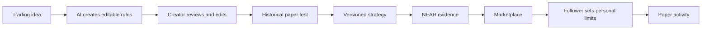
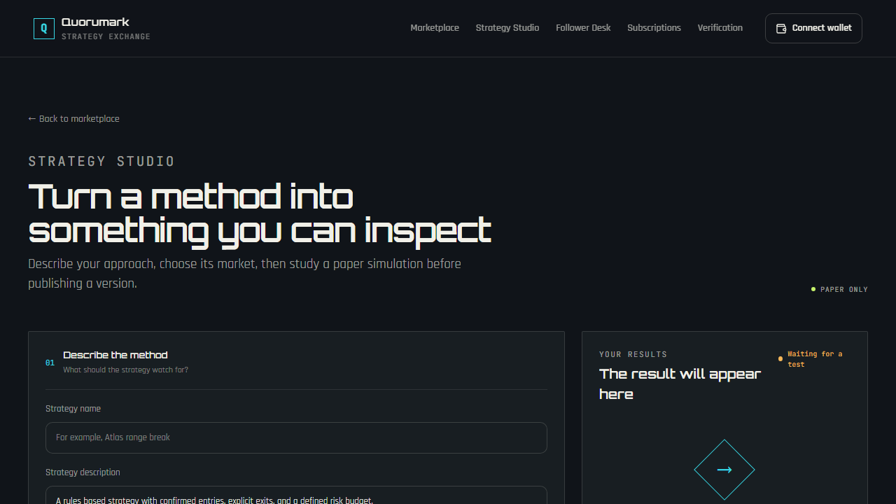
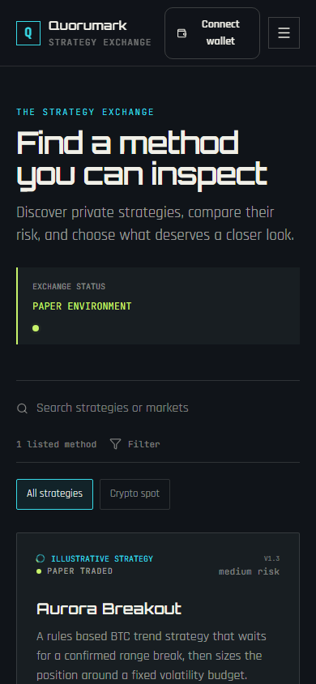
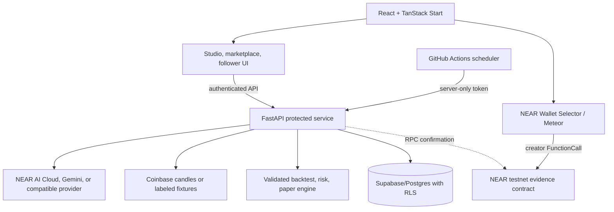

# Quorumark

Turning a trading idea into something a person can test, verify, share, and follow safely is difficult. Quorumark is an AI-powered marketplace for automated trading strategies: creators describe ideas, review editable rules, test paper versions, publish version-specific evidence through NEAR, and let followers participate with their own limits.

## Start here

- **Live application:** [quorumark-web.onrender.com](https://quorumark-web.onrender.com)
- **NEAR testnet evidence contract:** [quorumark-evidence-dedicated.testnet](https://testnet.nearblocks.io/address/quorumark-evidence-dedicated.testnet)

Quorumark is paper-only. It does not custody funds, place broker orders, or promise that a backtest predicts future returns.


## Try Quorumark

Public browsing does not require a wallet. Creating, saving, subscribing, and paper activity require authentication; genuine AI generation also requires the deployment's server-side AI credentials.

| Step | What to do | What you should see |
|---|---|---|
| 1 | Open the [live application](https://quorumark-web.onrender.com) and choose **Marketplace**. | Published strategy cards with descriptions, versions, paper-performance context, and limitations. |
| 2 | Choose **Inspect method** on a published strategy. | Its creator, published version, evidence status, subscription action, and available paper results. Private executable rules are not shown to unrelated followers. |
| 3 | Open **Strategy Studio** and enter “Create a cautious Bitcoin strategy that avoids unstable conditions.” | A plain-English idea field; no indicator knowledge is required. |
| 4 | Choose **Create my strategy**. | An AI proposal with a name, market, timing, rules, risk explanation, and provider/model provenance when available. |
| 5 | Review it, then choose **Test my strategy**. | A deterministic paper backtest with a chart, trade count, return, decline, costs, and a sample or historical data label. |
| 6 | Read the results and data-source label. | A simulation summary, not a live-performance claim. Fixtures remain labeled; public candles carry provider provenance. |
| 7 | Open **Verification** or evidence details. | Version-bound NEAR status and, when confirmed, a testnet transaction link. The blockchain record is not the private strategy definition. |
| 8 | Authenticate as a follower, open a published strategy, and choose **Subscribe**. | A version-pinned sandbox subscription with independent approved assets, trade, position, and loss limits. |
| 9 | Open **Follower Desk** and review a supported signal, or wait for autonomous evaluation when available. | A policy decision and deterministic paper receipt/history; follower limits can accept or reject independently. |

### Independent NEAR verification

No new publication or wallet signature is required:

1. Open the [contract account in NEARBlocks](https://testnet.nearblocks.io/address/quorumark-evidence-dedicated.testnet).
2. Open the confirmed [publication transaction](https://testnet.nearblocks.io/txns/FJcHvD37RmFdoaJkiUmKAc1Pyj54X6L2ZPbJUE6427NC).
3. Compare receiver, method, signer, strategy ID, version ID, and commitment with Quorumark’s evidence view.
4. Interpret it correctly: it proves a signer recorded a commitment for that version; it does not prove profitability or future performance.

Deployment/initialization is recorded in [CeFAFZv19R9nUPrKWTdX5MVZ6M8kQTencHHNNeUEsfNY](https://testnet.nearblocks.io/txns/CeFAFZv19R9nUPrKWTdX5MVZ6M8kQTencHHNNeUEsfNY). Fresh publication requires the creator’s NEAR testnet wallet and explicit ordinary `record_publication` approval. Quorumark does not request a seed phrase, private key, AddKey, FullAccess key, or mainnet transaction.

## What problem does Quorumark solve?

Trading ideas often get trapped in disconnected tools. A creator may write an idea in one place, test it elsewhere, share an unclear description, and leave followers with no way to identify the exact version they follow or how much simulated risk they accept.

Quorumark connects the workflow for **creators** who want editable, tested, versioned strategies and **followers** who want public information, evidence, and personal paper limits. It keeps private rules, simulated performance, and public evidence distinct.

## How the product works



## Product capabilities

### AI-assisted Strategy Studio

Beginners describe a goal in ordinary language, review the suggested name and rules, and refine or simplify the explanation. Quorumark produces a validated proposal containing market, interval, entry/exit logic, risk constraints, explanation, and provider/model provenance. An unavailable provider is reported; output is never fabricated.



### Historical testing

The creator chooses a supported market and interval and selects **Test my strategy**. Quorumark validates candle chronology and OHLCV integrity, then produces deterministic paper results: equity curve, simulated trades, return, biggest decline, fees, slippage, and data-source provenance. Fixtures are labeled as fixtures; public candles carry provider information. These are simulations, not forecasts.

### Marketplace and versions

Published versions are immutable. Editing one creates a new version rather than changing old evidence. Visitors can inspect the public description, creator, version, limitations, paper results, and verification state without receiving private executable rules.


### Followers and paper activity

Followers subscribe to a specific version and set approved assets, maximum trade, position, loss, and pause rules. Server-side checks enforce ownership, version pinning, and limits. Accepted activity creates deterministic paper records; rejected activity remains a policy decision. No broker or real-money signer is involved.



### Autonomous evaluation

The protected scheduler can evaluate eligible published executable versions against completed public candles. Keys include strategy, version, timestamp, and source, so retries do not duplicate evaluations or paper executions. This requires migrations, a scheduler token, eligible versions, and accessible market data; it is not a fixture demonstration.

## How AI is used

AI translates a human idea into structured rules and supports refinement and analysis. Quorumark validates the result, applies deterministic safety checks, and never executes model-generated code.

- **NEAR AI Cloud:** Integrated through its OpenAI-compatible chat endpoint. Render selects `AI_PROVIDER=near_ai`, `NEAR_AI_API_URL=https://cloud-api.near.ai/v1`, and `NEAR_AI_MODEL=google/gemini-2.5-flash-lite`. `NEAR_AI_API_KEY` is server-only. Availability still depends on key, model access, quota, and network.
- **Gemini:** Integrated as a selectable Google provider. Its model comes from server-only `AI_MODEL`; repository examples/tests use identifiers such as `gemini-3.5-flash` and `gemini-3.5-flash-lite`. It is an alternative configuration, not an automatic fallback silently mixed with NEAR AI.
- **OpenAI-compatible:** Also supported when selected, but not required by the deployed NEAR AI configuration.

Completed AI responses store the provider and model used. NEAR AI Cloud is the off-chain language-model role; NEAR blockchain is the separate on-chain evidence role.

## Why NEAR matters

A creator can change a strategy after sharing it. Followers need to identify the exact version associated with a publication without placing private rules, prompts, indicators, or backtest data on-chain.

Quorumark derives a canonical SHA-256 commitment from the strategy ID, immutable version ID, verified creator account, saved version-content hash, saved backtest reference, and publication metadata. The contract receives that commitment and the two IDs; it stores no private strategy parameters.

The current [quorumark-evidence-dedicated.testnet contract](https://testnet.nearblocks.io/address/quorumark-evidence-dedicated.testnet) binds the first record to the direct signer, rejects proxy calls and conflicting replacements, and lets the original signer retry the same commitment idempotently. A revised strategy gets a new version ID and commitment. Evidence identifies a signed version record; it does not prove profitability, data quality, future performance, or real-money execution.


## Technical architecture



Supabase stores strategies, versions, backtests, subscriptions, policies, evaluations, and evidence status. The browser never receives server-side AI keys, Supabase secret keys, or signing credentials. Local development can use SQLite; hosted mode uses Supabase and migrations.

## Technology stack

| Purpose | Technology | Role |
|---|---|---|
| User interface | React 19, TypeScript, TanStack Start/Router, Vite | Product routes and interactions |
| AI | NEAR AI Cloud, `google/gemini-2.5-flash-lite` in Render | Preferred configured structured-assistance provider |
| AI alternatives | Gemini via `AI_MODEL`; OpenAI-compatible adapter | Selectable server-side alternatives with provenance |
| Validation | Pydantic | AI proposals, executable rules, API payloads, risk inputs |
| Simulation | Python backtest and paper engine | Candles, equity, fees, slippage, policies, receipts |
| Market data | Coinbase public OHLCV; Binance/Kraken where enabled | Validated historical/completed-candle input |
| Persistence | Supabase/Postgres with RLS; SQLite locally | Strategies, evidence, subscriptions, paper records |
| NEAR | Wallet Selector, Meteor-compatible flow, Rust `near-sdk` | Wallet identity, authorization, commitment evidence |
| Automation | Protected GitHub Actions scheduler | Autonomous-evaluation trigger |
| Quality/deployment | Vitest, pytest, Playwright, Cargo, Render | Tests, builds, browser smoke checks, hosting |

## Local development

### Prerequisites

Install Node.js, Python 3.12 or compatible Python, and (for contract work) Rust/Cargo plus the NEAR toolchain. Supabase and a NEAR testnet wallet are optional for public browsing but required for hosted-style persistence and wallet verification.

```powershell
npm ci
Copy-Item .env.example .env.local
npm run dev:local
```

Manual backend:

```powershell
py -3.12 -m venv .venv
.\.venv\Scripts\Activate.ps1
python -m pip install -r backend\requirements.txt
python -m uvicorn app.main:app --reload --app-dir backend --port 8000
npm run dev
```

Use `VITE_PYTHON_BACKEND_URL=http://127.0.0.1:8000`. `QUORUMARK_PYTHON_ENVIRONMENT=local` uses `backend/.data/quorumark.db`. See [`.env.example`](.env.example) for public and server-only variables; never commit real values.

## Testing and release checks

```powershell
npx.cmd tsc --noEmit
npm.cmd run lint
npm.cmd test
pytest -q backend/tests
npm.cmd run build
npm.cmd run verify:production
```

```powershell
cd contracts/publication-evidence
cargo test
cargo build --target wasm32-unknown-unknown --release
```

The suites cover wallet/provider behavior, API exchange logic, AI provenance/failures, authorization, deterministic backtesting, market-data validation, publication evidence, paper execution, security, and autonomous-evaluation idempotency. `tests/e2e/smoke.spec.ts` covers browser smoke routes. Automated tests do not approve wallet prompts or fabricate live provider results.

## Current limitations

- Paper only: no real-money trading, brokerage execution, custody, or withdrawals.
- Historical and fixture results are simulations, not forecasts or guarantees.
- NEAR evidence is testnet, not mainnet settlement.
- A commitment does not prove profitability, data quality, or execution.
- AI needs a valid private key, supported model access, quota, and network.
- Autonomous evaluation needs migrations, scheduler credentials, eligible versions, and accessible candles.
- Fresh on-chain publication requires explicit creator wallet approval.
- Render free services can sleep or cold-start.
- The current checkout contains no `LICENSE` file; no project license should be inferred from dependency licenses.

## Repository guide

```text
src/                         React/TanStack application and routes
src/components/exchange/     Studio, marketplace, follower, verification UI
src/lib/                     API, wallet, NEAR, strategy helpers
backend/app/                 FastAPI, AI, data, backtest, paper engine
backend/tests/               Python API and engine tests
contracts/publication-evidence/ Rust NEAR contract and tests
supabase/migrations/         Hosted schema and RLS migrations
tests/e2e/                   Playwright smoke tests
docs/                        NEAR notes and selected README assets
scripts/                     Local, production-asset, deployment helpers
render.yaml                  Free Render frontend/backend blueprint
```

## NEAR Hackathon submission

NEAR provides wallet identity and independently inspectable testnet evidence for immutable strategy versions. AI, data, backtests, subscriptions, and paper activity remain off-chain. Start with the [live application](https://quorumark-web.onrender.com), follow the [Try Quorumark](#try-quorumark) table, then inspect the [confirmed transaction](https://testnet.nearblocks.io/txns/FJcHvD37RmFdoaJkiUmKAc1Pyj54X6L2ZPbJUE6427NC) and [contract account](https://testnet.nearblocks.io/address/quorumark-evidence-dedicated.testnet).

## License

No `LICENSE` file is present in the current repository checkout, so Quorumark has no declared project license in this revision. This README does not modify or infer a license.
