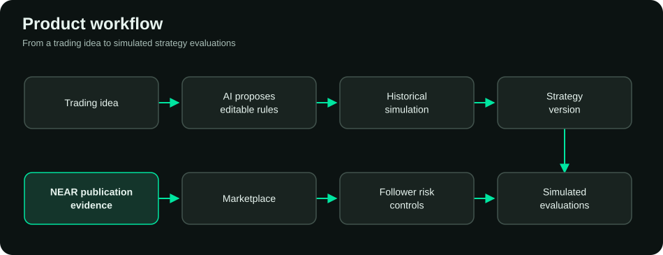
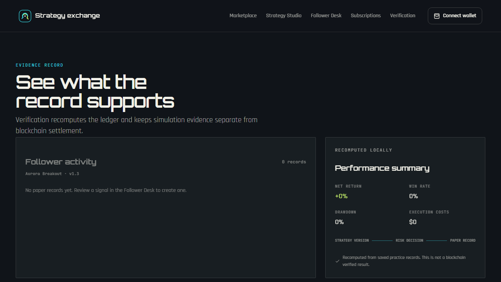
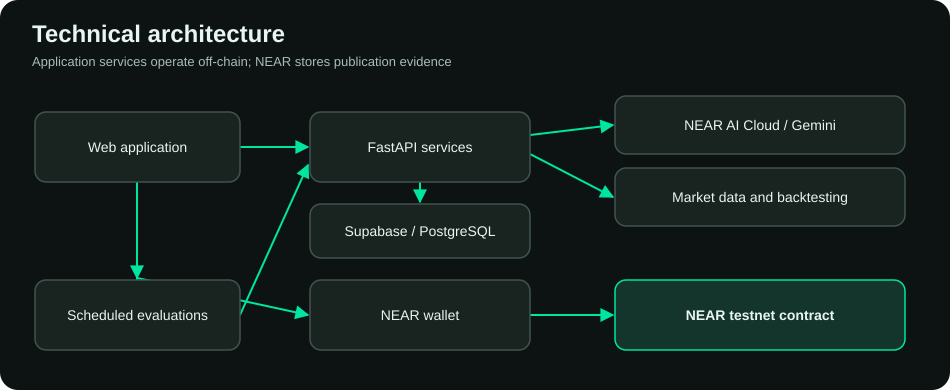

# Quorumark

Creating an automated trading strategy usually requires several tools: one to define the rules, another to test them, and another to share the results. For someone considering following that strategy, there is an additional question: **how can they tell which version of the rules produced the published results?**

**Quorumark is a marketplace where creators can build automated trading strategies with AI, test them using historical market data, and publish strategies for others to explore.** Followers can review simulated performance and choose their own risk limits. NEAR provides an independently inspectable record of the strategy version a creator publishes, without requiring the creator to reveal private trading rules.

**[Open Quorumark](https://quorumark-web.onrender.com)** | **[Inspect a NEAR testnet publication](https://testnet.nearblocks.io/txns/FJcHvD37RmFdoaJkiUmKAc1Pyj54X6L2ZPbJUE6427NC)**


> **Current scope:** Strategy testing and automated evaluation use simulated trading. Quorumark does not place trades with real money. Historical performance is not a guarantee of future results.

---

## Try Quorumark

The [public application](https://quorumark-web.onrender.com) is the quickest way to understand the product. This walkthrough identifies the action to take and the result to look for. Some creation and publication actions require account configuration, AI-provider access, or NEAR testnet wallet approval.

| Do this | See this |
| --- | --- |
| **1. Open Marketplace.** Select an available strategy. | Its description, available simulated performance, and supporting information. |
| **2. Open Strategy Studio.** Enter a trading idea in ordinary language. | A proposed set of entry, exit, and risk rules that can be reviewed and edited, when AI access is configured. |
| **3. Change a rule.** Adjust an available entry, exit, or risk setting. | The updated strategy configuration. |
| **4. Run a historical test.** Use the available market data and testing controls. | Simulated trades, performance figures, and a chart of simulated account value. |
| **5. Examine the results.** Check drawdown, trade history, fees, and other available metrics. | Information about both simulated returns and the risks and costs behind them. |
| **6. Open Verification.** Inspect a strategy with published evidence. | Its version-linked commitment and available NEAR testnet details. |
| **7. Open the follower controls.** Review the available risk settings. | Limits that can be set independently of the strategy creator's preferences. |
| **8. Open Decisions or Activity.** Inspect recorded evaluations. | Decisions produced by the evaluation system, including cases where it takes no action. |

**A sample idea for Strategy Studio:**

> Create a strategy that uses a moving-average crossover for entry and exit signals. Include a stop-loss and a limit on risk per trade.

The generated rules should be reviewed before testing. The example illustrates the input format; it does not imply the strategy is profitable or that every requested setting will be supported.

**You can verify the blockchain integration without signing in.** [Open the recorded NEAR transaction](https://testnet.nearblocks.io/txns/FJcHvD37RmFdoaJkiUmKAc1Pyj54X6L2ZPbJUE6427NC), check its receiver and status, and inspect the `record_publication` call. Publishing a new commitment requires explicit wallet authorization.

---

## What you can do with Quorumark

### Create a strategy using AI

Strategy Studio accepts a plain-language trading idea and uses AI to propose structured rules. The creator can inspect and edit the available entry conditions, exit conditions, and risk settings. The output is a strategy proposal, not an instruction to invest or a guarantee of performance.


### Test the strategy using historical data

Quorumark's backtesting engine simulates how the rules would have behaved on historical market data. Results can include simulated returns, trade history, changes in account value, maximum drawdown, fees, and slippage.

The reference engine uses **next-candle-open execution** to avoid letting a strategy act on market information that was not yet available at the time of its decision. This improves the integrity of the simulation but cannot predict future performance.


### Publish and discover strategies

Creators can make strategies discoverable in the marketplace alongside their descriptions, available simulated results, and verification evidence. They can share information about a strategy without publishing the full private rule set.


### Set independent follower risk limits

A follower's risk preferences do not have to match the creator's. Quorumark separates strategy rules from the follower's available risk controls within its simulated environment.


### Review automated decisions

Quorumark can evaluate supported strategies against market data and record the decisions. An evaluation can result in no trade. Such outcomes are retained rather than inventing activity for the demonstration.

### Product workflow



---

## Why Quorumark uses NEAR

A performance report alone cannot establish whether a strategy's rules have changed since that report was produced. A creator might test one version, publish its results, and later modify the strategy. A follower needs a way to inspect evidence tied to the published version without depending entirely on Quorumark's database.

**NEAR enables wallet-authorized publication of cryptographic commitments to strategy versions.** This gives Quorumark a record that can be inspected outside the application, while the private trading rules remain off-chain.

The process is:

1. Quorumark associates a cryptographic commitment with a specific strategy version.
2. The creator approves publication using a NEAR-compatible wallet.
3. The evidence contract records the commitment on NEAR testnet.
4. A reviewer can inspect the transaction and compare its recorded identifiers and commitment with the corresponding evidence in Quorumark.



### Inspect the on-chain evidence

| Item | Evidence |
| --- | --- |
| Network | NEAR Testnet |
| Contract | [`quorumark-evidence-dedicated.testnet`](https://testnet.nearblocks.io/address/quorumark-evidence-dedicated.testnet) |
| Recorded transaction | [View publication transaction](https://testnet.nearblocks.io/txns/FJcHvD37RmFdoaJkiUmKAc1Pyj54X6L2ZPbJUE6427NC) |
| Contract method | `record_publication` |

**Do this:** Open the transaction link, confirm that the receiver is `quorumark-evidence-dedicated.testnet`, and inspect the successful `record_publication` call.

**See this:** A blockchain record containing publication data that can be compared with the matching strategy-version evidence shown by Quorumark.

The commitment establishes that particular evidence was recorded on-chain. **It does not prove profitability, independently validate private strategy rules, or execute trades.** NEAR is used for publication evidence, not for historical simulation or live trade execution.

---

## How AI is used

Quorumark uses AI to translate natural-language strategy descriptions into editable proposals and to support strategy refinement and analysis. The application records provider and model information for supported AI requests.

The repository implements two selectable AI providers:

| Provider | Configuration identified in the repository | What it does |
| --- | --- | --- |
| **NEAR AI Cloud** | `AI_PROVIDER=near_ai`, `NEAR_AI_MODEL=google/gemini-2.5-flash-lite`, endpoint `https://cloud-api.near.ai/v1` in the checked-in Render configuration | Handles strategy proposals, refinement, and analysis through the configured provider interface. |
| **Google Gemini** | Alternative provider selected through server configuration. Repository examples and tests reference `gemini-3.5-flash` and `gemini-3.5-flash-lite`. | Supports the same AI workflows when selected and supplied with valid credentials. |

The providers are **configuration alternatives**, not an automatic fallback chain. Credentials remain on the server. An unavailable provider returns an error rather than a fabricated result.

**NEAR AI Cloud and NEAR blockchain have separate roles:** NEAR AI Cloud serves AI inference requests; the NEAR testnet contract records strategy-version commitments.

---

## Implementation and verification

This section is for technical reviewers who want to inspect the code or reproduce the available checks.

### Technology stack

| Component | Implementation |
| --- | --- |
| Web application | React, TypeScript, TanStack |
| AI inference | NEAR AI Cloud and Google Gemini |
| Historical testing and evaluations | Python, FastAPI |
| Data storage | Supabase, PostgreSQL, row-level security |
| Market data | Coinbase and other supported integrations |
| Blockchain evidence | NEAR testnet smart contract |
| Wallet authorization | NEAR Wallet Selector |
| Scheduled evaluations | Protected scheduler and application services |

### Architecture

The application handles AI requests, strategy logic, market data, backtesting, and follower settings off-chain. The NEAR contract stores selected publication evidence.



### Run locally

The repository includes `.env.example` and deployment configuration in `render.yaml`. Local development requires Node.js/npm and Python 3.12. Database-backed features require a configured Supabase/PostgreSQL project. AI inference and new on-chain publications require their respective credentials or wallet approval.

**Frontend and local launcher (PowerShell):**

```powershell
npm ci
Copy-Item .env.example .env.local
npm run dev:local
```

**Alternatively, start the backend separately:**

```powershell
py -3.12 -m venv .venv
.\.venv\Scripts\Activate.ps1
python -m pip install -r backend\requirements.txt
python -m uvicorn app.main:app --reload --app-dir backend --port 8000
```

Then start the frontend in another terminal:

```powershell
npm run dev
```

Set `VITE_PYTHON_BACKEND_URL=http://127.0.0.1:8000` for the local backend connection. Apply the repository's Supabase migrations to the intended database when persistent features are needed. Do not commit API keys or wallet secrets.

### Run the checks

```powershell
npx.cmd tsc --noEmit
npm.cmd run build
python -m pytest -q backend/tests --basetemp .pytest-tmp
cd contracts/publication-evidence
cargo test
```

The previously recorded checks reported **41 passing backend tests**, **5 passing Rust contract tests**, and successful TypeScript and production-build checks. These results are from the project's supplied documentation; they have not been rerun as part of this README edit. The repository also includes Vitest frontend tests and `tests/e2e/smoke.spec.ts` browser tests.

### What reviewers can verify

| Claim | Where to check |
| --- | --- |
| AI-assisted creation produces editable rules | Strategy Studio and the AI integration |
| Historical testing models costs and simulated trades | Backtest interface, Python engine, and tests |
| Strategy-version evidence is recorded on NEAR | [Published testnet transaction](https://testnet.nearblocks.io/txns/FJcHvD37RmFdoaJkiUmKAc1Pyj54X6L2ZPbJUE6427NC) |
| Followers can set separate risk controls | Follower desk and its implementation |
| Automated evaluations record decisions | Decisions / Activity and evaluation code |
| Trading execution is simulated | Paper-execution paths and tests |

---

## License

See the existing [LICENSE](LICENSE) file.
