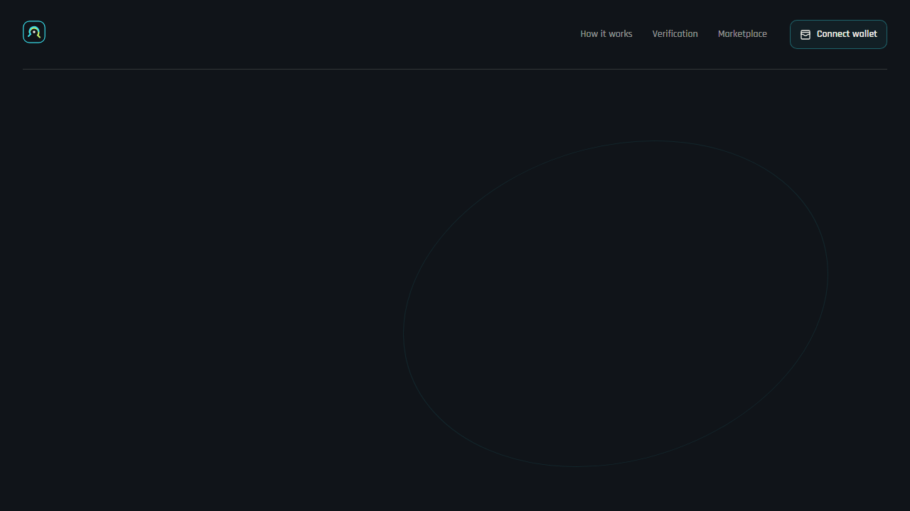
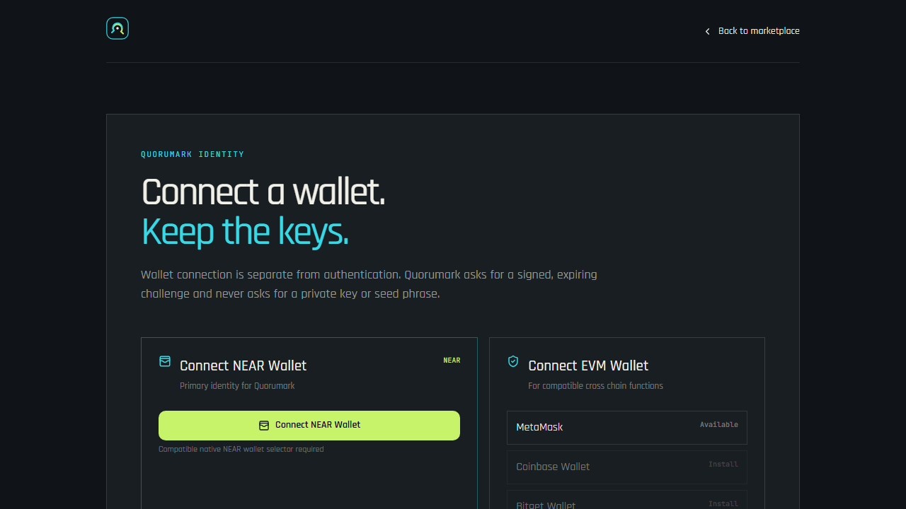
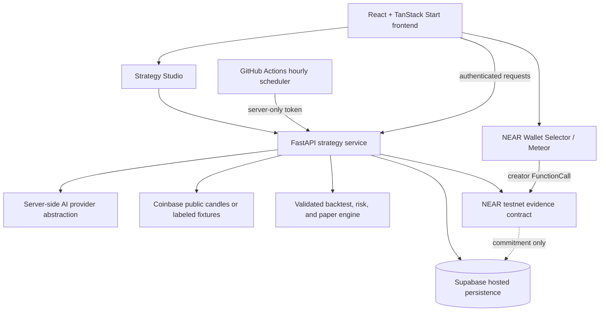

# Quorumark

Turning a trading idea into an automated strategy that can be tested, evaluated, shared, and followed without exposing private rules or giving followers unlimited risk is difficult. Quorumark is an AI-powered marketplace for automated trading strategies: creators build and test versioned strategies, publish inspectable evidence, and followers discover strategies while keeping independent paper-trading limits.

- Live application: [quorumark-web.onrender.com](https://quorumark-web.onrender.com)
- Backend health: [quorumark-api.onrender.com/health](https://quorumark-api.onrender.com/health)
- Repository: [github.com/Kunmiesther/quorumark](https://github.com/Kunmiesther/quorumark)
- NEAR testnet contract: [quorumark-evidence-dedicated.testnet](https://testnet.nearblocks.io/address/quorumark-evidence-dedicated.testnet)

## Product overview

Quorumark serves strategy creators and followers. Creators describe strategies in ordinary language, review AI-generated rules, test them against labeled data, save immutable versions, and publish them. Followers browse published versions, inspect limitations and evidence, subscribe in the sandbox, and apply risk rules to their own paper activity.



## What Quorumark solves

Strategy creation, historical testing, evidence, distribution, and follower risk controls are usually disconnected. Quorumark puts them in one workflow:

```mermaid
flowchart LR
  A[Trading idea] --> B[AI-assisted creation]
  B --> C[Inspect and edit rules]
  C --> D[Deterministic paper backtest]
  D --> E[Immutable strategy version]
  E --> F[NEAR testnet commitment]
  F --> G[Marketplace discovery]
  G --> H[Version-pinned subscription]
  H --> I[Independent follower policy]
  I --> J[Paper evaluation and execution]
```



## Product capabilities

### Strategy Studio

`/studio` accepts a plain-English idea. The backend calls the configured server-side AI provider, validates structured output with Pydantic models, stores provider/model provenance, and returns a proposal with a suggested name, market, timing, rules, and risk explanation. Refinement, analysis, and agent assessment use the same provider abstraction. AI is never replaced with fabricated output.


### Backtesting

The Python engine validates candle chronology and OHLCV integrity, then calculates deterministic paper results, fees, slippage, return, drawdown, and an equity curve. Offline runs can use clearly labeled fixtures. The public adapter uses Coinbase Exchange candles when configured and records its source and mapping. Results are simulations, not forecasts.

### Marketplace and versions

Published strategies are discoverable through `/marketplace` and detail routes. A version contains a validated executable specification and remains immutable after publication. Editing a published strategy creates a new version. Private definitions are not returned to unrelated followers.


### NEAR publication evidence

The frontend prepares a `record_publication` FunctionCall through NEAR Wallet Selector. The creator's connected testnet account signs the ordinary transaction; the browser receives no private key. The backend confirms the finalized receipt, receiver, signer, method arguments, and commitment through RPC before showing verified status.

### Follower controls and paper execution

Followers subscribe to a specific published version. Their policy is enforced server-side: approved assets, maximum trade, maximum position, maximum loss, pause state, fees, and slippage. A signal can be accepted or rejected by that policy. Accepted activity produces a deterministic paper receipt; no broker or real-money signer is called.


### Autonomous evaluation

A protected hourly scheduler evaluates published executable versions against completed public candles. Evaluations are keyed by strategy, version, candle timestamp, and source, so retries skip an already processed observation. Signals go only to active, version-pinned subscriptions. Fixture practice signals are separate from autonomous market-data records.


## Why NEAR matters

Quorumark commits a canonical, domain-separated publication record containing the strategy ID, immutable version ID, verified creator NEAR account, saved version content hash, saved backtest reference, and publication schema/network metadata.

The SHA-256 commitment is passed to `record_publication` with `strategy_id` and `version_id`. The deployed contract stores one record per strategy/version key, binds the first record to the transaction signer, rejects a different commitment, and allows the original signer to retry the identical record. It stores no strategy parameters or private rules.

The active contract is [quorumark-evidence-dedicated.testnet](https://testnet.nearblocks.io/address/quorumark-evidence-dedicated.testnet) on NEAR testnet. The repository records deployment/initialization as [CeFAFZv19R9nUPrKWTdX5MVZ6M8kQTencHHNNeUEsfNY](https://testnet.nearblocks.io/txns/CeFAFZv19R9nUPrKWTdX5MVZ6M8kQTencHHNNeUEsfNY) and the confirmed existing publication as [FJcHvD37RmFdoaJkiUmKAc1Pyj54X6L2ZPbJUE6427NC](https://testnet.nearblocks.io/txns/FJcHvD37RmFdoaJkiUmKAc1Pyj54X6L2ZPbJUE6427NC).



When a strategy changes, its new version gets a different version ID and commitment. NEAR evidence shows what a signer committed for a specific version; it does not prove profitability, data quality, future performance, or paper-trade execution.

## Architecture



Off-chain Supabase records contain strategies, versions, backtests, subscriptions, policies, evaluations, and evidence status. Local development also has an explicit SQLite adapter.

## Technology stack

| Technology | Purpose | Location |
|---|---|---|
| React 19 + TypeScript | Product UI | `src/` |
| TanStack Start/Router | SSR-aware app and routes | `src/routes/` |
| Vite 8 | Frontend build | `vite.config.ts` |
| FastAPI + Pydantic | Protected APIs and validation | `backend/app/` |
| Supabase/Postgres | Hosted persistence and RLS | `supabase/migrations/` |
| SQLite | Local development ledger | `backend/app/repository.py` |
| NEAR Wallet Selector | Testnet connection/signing | `src/lib/wallet/near.ts` |
| Rust + near-sdk 5.17 | Evidence contract | `contracts/publication-evidence/` |
| Coinbase public API | OHLCV adapter | `backend/app/historical_data.py` |
| Vitest, pytest, Playwright | Automated tests | `tests/`, `backend/tests/` |


## Try Quorumark

### Product walkthrough

1. Open the [live application](https://quorumark-web.onrender.com). Observe the public landing page.
2. Open Marketplace and select a published strategy. Observe its description, version, evidence class, limitations, and paper results. This demonstrates discovery without exposing private rules.
3. Open Strategy Studio and describe a cautious Bitcoin strategy in ordinary English. Observe the AI proposal and provider/model provenance when AI credentials are configured.
4. Review or refine the proposal, then run the clearly labeled sample-data backtest. Observe deterministic metrics and the data-source label.
5. Connect a NEAR testnet wallet only when testing authentication or creator publication. Never enter a seed phrase or private key into Quorumark.
6. Save a draft, create an immutable version, publish it, refresh, and confirm the marketplace record remains available.
7. In Follower Desk, subscribe to a published version in the sandbox and configure approved assets, maximum trade, and maximum loss.
8. Submit a supported paper signal or wait for autonomous evaluation. Observe policy acceptance/rejection and inspect the paper receipt/history.
9. Open Verification to see recomputed paper-ledger results and NEAR evidence status.

### NEAR verification walkthrough

1. Use a NEAR testnet wallet account that is also the creator identity for the published version.
2. Confirm receiver `quorumark-evidence-dedicated.testnet`, network testnet, method `record_publication`, deposit `0 NEAR`, and gas `30 Tgas`.
3. Approve the ordinary FunctionCall. Quorumark does not request AddKey, FullAccess, deployment, or mainnet transactions for publication.
4. Wait for finalization. The backend checks signer, receiver, arguments, IDs, and commitment through NEAR RPC before marking evidence confirmed.
5. Inspect the [confirmed testnet transaction](https://testnet.nearblocks.io/txns/FJcHvD37RmFdoaJkiUmKAc1Pyj54X6L2ZPbJUE6427NC) and [contract account](https://testnet.nearblocks.io/address/quorumark-evidence-dedicated.testnet).

A fresh wallet approval is a manual action; browser tests do not impersonate wallet approval.

## Local development

### Prerequisites

Node.js compatible with the Vite/TanStack toolchain, Python 3.12 recommended for FastAPI, and Rust/Cargo plus the NEAR toolchain for contract work. A Supabase project and NEAR testnet wallet are optional.

### Install and run

```powershell
npm ci
Copy-Item .env.example .env.local
npm run dev:local
```

Manual backend:

```powershell
py -3.12 -m venv .venv
.\.venv\Scripts\Activate.ps1
python -m pip install -r backend\requirements.txt
python -m uvicorn app.main:app --reload --app-dir backend --port 8000
npm run dev
```

Set `VITE_PYTHON_BACKEND_URL=http://127.0.0.1:8000`. `QUORUMARK_PYTHON_ENVIRONMENT=local` uses `backend/.data/quorumark.db`. Hosted Supabase mode requires server-only values in `.env.example` and applied migrations. Never commit environment files, provider keys, session secrets, or Supabase secret keys.

### Environment variables

Public: `VITE_APP_URL`, `VITE_PYTHON_BACKEND_URL`, `VITE_SUPABASE_URL`, `VITE_SUPABASE_PUBLISHABLE_KEY`, `VITE_NEAR_NETWORK`, `VITE_NEAR_RPC_URL`, and `VITE_NEAR_EVIDENCE_CONTRACT_ID`.

Server-only: `QUORUMARK_SUPABASE_SECRET_KEY`, `QUORUMARK_SESSION_SECRET`, `NEAR_AI_API_KEY` or `AI_API_KEY`, `QUORUMARK_EVALUATION_SCHEDULER_TOKEN`, and contract configuration. For NEAR AI Cloud use `AI_PROVIDER=near_ai`, `NEAR_AI_API_URL=https://cloud-api.near.ai/v1`, and a model returned by its catalog. Credentials never belong in `VITE_*` variables.

### Checks and build

```powershell
npx.cmd tsc --noEmit
npm.cmd run lint
npm.cmd test
pytest -q backend/tests
npm.cmd run build
npm.cmd run verify:production
```

Contract checks:

```powershell
cd contracts/publication-evidence
cargo test
cargo build --target wasm32-unknown-unknown --release
```

Apply Supabase migrations to the intended project using the Supabase CLI or SQL editor; do not reset a hosted database.

## Testing and verification

Frontend tests cover wallet/provider selection, NEAR helpers, API behavior, and strategy exchange logic. Backend tests cover authorization, AI provider provenance, deterministic backtesting, historical-data validation, publication evidence, paper execution, security, and autonomous-evaluation idempotency. `tests/e2e/smoke.spec.ts` covers browser smoke routes and navigation.

Automated tests do not approve Meteor Wallet prompts, fabricate provider responses, or claim a live transaction. Live AI, Supabase, wallet, Render, and NEAR checks require configured services and are reported separately.

## Current limitations

- All trading is paper/sandbox only. There is no brokerage, custody, or real-money execution.
- Backtests use labeled fixtures or public historical candles and do not guarantee future performance.
- NEAR integration is testnet evidence, not mainnet settlement or profitability verification.
- The contract records a creator-signed, version-bound commitment and stores no private rules.
- AI requires a valid server-side provider key, supported model, quota, and network access; unavailable AI is reported rather than fabricated.
- Render free services can sleep or cold-start and require private dashboard configuration.
- Wallet approval and fresh on-chain publication are manual human actions.
- Autonomous evaluation requires its Supabase migrations, scheduler token, eligible published version, and accessible completed candles.
- No `LICENSE` file is present, so the repository has no declared open-source license.

## Repository structure

```text
src/                         React/TanStack application and routes
src/components/exchange/     Studio, marketplace, follower UI
src/lib/                     API, wallet, NEAR, strategy helpers
backend/app/                 FastAPI, AI, data, backtest, paper engine
backend/tests/               Python API and engine tests
contracts/publication-evidence/ Rust NEAR contract and tests
supabase/migrations/         Hosted schema and RLS migrations
tests/e2e/                   Playwright smoke tests
docs/                        NEAR/manual verification notes
docs/assets/                 Selected README screenshots
scripts/                     Local launcher, Render adapter, asset checks
render.yaml                  Free Render frontend/backend blueprint
```

## NEAR Hackathon submission

Quorumark is a NEAR Hackathon submission. NEAR contributes wallet identity and independently inspectable testnet evidence for immutable strategy versions. AI, data, backtesting, subscriptions, and paper execution remain off-chain; only the publication commitment is recorded on-chain.

Judges can start with the live links, follow the walkthrough, inspect the contract account and confirmed transaction, and run local checks. Evidence links are testnet links and are not mainnet or profitability claims.

## License

No `LICENSE` file is present in this repository. The project is not published under a declared open-source license.
